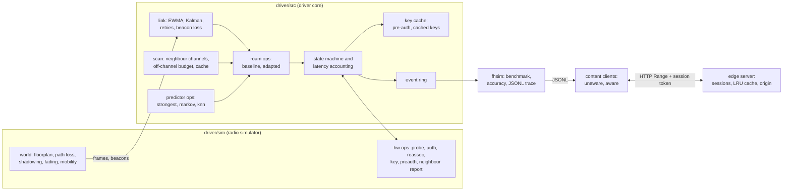

# wifi-fasthandoff

Fast Wi-Fi handoff at the driver level, adapted for mobile clients, with a content-delivery layer that keeps streams and downloads continuous across access-point changes.


The driver logic is C11 written in kernel style (no allocation in the hot path, fixed-size rings, an explicit state machine, ops tables of function pointers). It runs as a user-space simulation against a seeded radio model; it is not a loadable kernel driver. The content layer is Python: a streaming client, a downloader and a small edge server that replay the driver's event stream over real HTTP.

## What it demonstrates

- **Link metrics the way a driver keeps them.** Fixed-point EWMA of RSSI and SNR, a 64-frame retry bitmap, beacon-loss counting, and a two-state Kalman filter (level and slope) that separates the trend of walking or driving from fast fading.
- **Selective background scanning.** Channel lists come from 802.11k-style neighbour reports, off-channel time is capped at 40 ms per 500 ms window, and a candidate cache ages entries out after 2 s. When a handoff is imminent the predicted APs' channels move to the front of the list.
- **An adapted handoff decision against a classic one.** The baseline roams below a hard -75 dBm threshold and sweeps the band. The adapted policy arms early on a Kalman forecast one second ahead, then moves only when a candidate beats the serving AP by 5 dB after a load penalty for 240 ms without interruption, with a minimum dwell and a larger margin for going straight back.
- **A learned next-AP predictor, measured.** A first-order Markov chain over AP transitions (the state is the last transition, so it carries the direction of travel) is combined with the cached signal as one HMM-style step. A KNN over RSSI fingerprints and a strongest-neighbour rule run side by side, and `fhsim` reports top-1 accuracy and a learning curve against the amount of history.
- **Fast transition with latency accounting.** Pre-authentication over the current AP installs a cached key for likely targets (an abstract model of 802.11r key reuse, with a hash standing in for key derivation), so the key phase drops from a full 802.1X exchange to an install. Every handoff is broken down into scan, auth, reassoc and key time.
- **A netlink-style event channel (RFC 3549).** A lock-free single-producer ring delivers `HANDOFF_IMMINENT` (predicted target and ETA), `HANDOFF_START`, `HANDOFF_DONE` (latency breakdown, subnet change) and `LINK_DEGRADED`, with group subscription and an `ENOBUFS` report after overflow.
- **Content continuity across address changes.** The handoff-aware client prefetches on `HANDOFF_IMMINENT`, starts no request during the transition, and resumes with HTTP byte ranges and a session token after `HANDOFF_DONE`; the server continues the same session from the new address.

## Architecture



The driver core (`driver/src`) does no I/O and no allocation; it talks to the radio only through `struct fh_hw_ops` and to user space only through the event ring. Policy lives behind `struct fh_roam_ops` and prediction behind `struct fh_pred_ops`, so the same state machine runs both algorithms. The simulator (`driver/sim`) implements the hardware ops on top of a log-distance path loss model with spatially correlated shadowing and Rician fading, a 400 m corridor with 8 APs and a 4 x 4 campus street grid with 16 APs on the 1/6/11 channel plan, and walking or vehicle mobility. The harness plays a 50 packet/s downlink flow and drains the event ring the way a user-space listener would, writing each event to a JSONL trace together with the goodput the link offers every 250 ms. The content layer (`content/fhcontent`) replays those traces: bytes move over real HTTP on loopback, and every chunk read from the socket is charged to the trace's link rate on a simulated clock, so a handoff cuts a transfer at the right byte.

## Quickstart

Requirements: a C11 compiler and CMake 3.20 or later; Python 3.11 or later. The Python dev dependencies are pytest and ruff.

```sh
cmake -S . -B build -DCMAKE_BUILD_TYPE=Release
cmake --build build -j
ctest --test-dir build --output-on-failure

./build/fhsim --runs 20            # baseline vs adapted, 20 seeded runs per scenario
./build/fhsim --runs 10 --curve    # predictor accuracy vs amount of history

python3 -m venv .venv && . .venv/bin/activate
pip install -e ".[dev]"
ruff check .
pytest

mkdir -p traces
./build/fhsim --runs 5 --scenario campus-vehicle --trace-dir traces
python -m fhcontent.compare --traces traces
```

`fhsim --runs 20` (latency in ms, phases are means per handoff; `lost/ho` counts packets lost in the second before a handoff and during it):

```
scenario        algo       ho/run pingpong aborted lat_mean  lat_p95   scan  auth reassoc   key  lost/ho    loss% outage_s   ft%
corridor-walk   baseline     17.4     3.45    7.95    266.7      294  146.9   4.3     4.3 111.2    19.46     1.10     5.81     0
corridor-walk   adapted      13.5     0.00    1.30     32.6       51   22.6   5.0     4.0   1.0     1.64     0.12     0.47   100
campus-walk     baseline     11.8     1.15    0.70    272.6      296  150.9   4.0     4.2 113.6    15.90     0.83     3.31     0
campus-walk     adapted       9.5     0.10    0.20     45.7       74   35.7   5.0     4.0   1.0     2.08     0.12     0.44   100
campus-vehicle  baseline     15.8     0.20    0.30    275.8      296  151.0   4.1     4.0 116.8    14.76     3.45     4.42     0
campus-vehicle  adapted      15.1     0.05    0.50     41.7       74   31.3   5.0     4.0   1.4     1.98     0.49     0.64   100

next-AP predictor, top-1 accuracy (prediction at HANDOFF_IMMINENT, truth: best AP 1 s after the handoff)
scenario        decisions  strongest     markov        knn
corridor-walk         269      81.8%      91.1%      84.8%
campus-walk           190      59.5%      58.9%      38.4%
campus-vehicle        298      15.8%      39.9%      37.6%
```

The predictor gains most where direction matters and the scan cache is thin: a vehicle reaches the next intersection before background scanning has heard the APs around the corner, so signal alone picks the right AP one time in six, while transition history picks it two times in five. On a campus at walking pace the cache is complete and history adds little. `--curve` shows the learned predictors improving with history (campus-vehicle, Markov: 21% with none, 32% after one walk, 45% after eight) while the strongest-neighbour rule stays flat.

`python -m fhcontent.compare` (means per trace; a 4 Mbit/s stream with a 6 s buffer target, then a 48 MB download):

```
   driver   client traces handoffs stalls stall_s restarts   redl_MB resumes  dl_ok  dl_time  dl_redl_MB
adapted   aware         5     15.8   0.00    0.00     0.00      0.00    4.20    5/5     24.0        0.00
adapted   unaware       5     15.8   0.20    0.08     2.80      1.42    0.00    5/5     45.2       33.88
baseline  aware         5     16.4   0.00    0.00     0.00      0.00    2.60    5/5     27.7        0.00
baseline  unaware       5     16.4   0.00    0.00     2.80      1.05    0.00    4/5     62.2       69.14
```

At this buffer size stalls are rare for every combination. What the viewer's device pays for is the address change: the unaware client restarts its session about three times per trace and throws away partly received objects, and its download takes twice as long or does not finish. The faster driver shortens the aware download by 13% because outages are shorter.

## Design decisions

1. **Ops tables for policy, prediction and hardware.**
   *Decision:* the driver core calls `fh_roam_ops`, `fh_pred_ops` and `fh_hw_ops` through function pointers, as a driver does with firmware and rate control.
   *Why:* baseline and adapted run on the same state machine, latency accounting and event code, so the comparison measures the policy and nothing else; the simulator replaces the radio without touching the core.
   *Trade-off:* policies read driver state directly (the struct is public), which is less encapsulated than a narrow interface, and indirect calls cost a little on every tick.

2. **The forecast arms the handoff, measured levels decide it.**
   *Decision:* the Kalman forecast triggers `HANDOFF_IMMINENT`, prioritised scanning and pre-authentication; the switch itself needs a measured margin held for the time-to-trigger, a quality floor on the target, a 2 s minimum dwell and 6 dB extra to go straight back.
   *Why:* a first version compared the candidate against the forecast. In a five-run check it moved early but produced 6.2 ping-pongs per vehicle run against none for the baseline, because forecast noise looks like a better neighbour. Splitting "when to prepare" from "whether to move" brought it to 0.05.
   *Trade-off:* the move happens a few hundred ms later than a purely predictive rule would make it, and there are more thresholds to tune per deployment.

3. **Make before break.**
   *Decision:* pre-authenticate with the top predicted APs while still associated, and when the time-to-trigger has elapsed wait up to 300 ms more for the key to be ready before leaving.
   *Why:* in the baseline the key phase is the largest cost after scanning (a full 802.1X exchange, about 115 ms); with a cached key it is an install of about 1 ms, and 100% of adapted handoffs use one.
   *Trade-off:* pre-authentication traffic to APs that are never used, and keys that expire unused; the cache is bounded at 16 entries.

4. **Common random numbers for a paired comparison.**
   *Decision:* fast fading, frame errors and jitter come from a counter-based generator keyed by (seed, AP, time, kind), not from a sequential stream.
   *Why:* the two policies query the channel at different moments and different numbers of times. With a sequential generator they would see different fading for the same walk and the comparison would mostly measure noise; with keyed draws the same frame at the same time always sees the same channel.
   *Trade-off:* fading is independent from frame to frame, with no Doppler correlation, which is optimistic for the smoothing filters at walking speed.

5. **Markov prior times signal likelihood.**
   *Decision:* the Markov predictor scores a candidate as log P(next | last transition) plus its cached RSSI over a 3 dB temperature, with backoff to P(next | current) and additive smoothing; KNN stays as a second learned model.
   *Why:* with counts alone a single historical transition outweighed a 20 dB signal difference and accuracy fell below the strongest-neighbour rule. The combined form is never worse than either input by much and is much better where direction matters. KNN needs more history to separate fingerprints, which the learning curve shows.
   *Trade-off:* the temperature is a hand-set constant, not learned, and the model ignores time of day or speed.

6. **A JSONL trace between C and Python, not a shared library.**
   *Decision:* `fhsim` writes driver events and link samples as JSONL; the content layer reads them.
   *Why:* no ABI coupling or build step for Python, traces can be committed and replayed in tests, and CI never depends on loading native code. The event ring is still the driver's API; the trace is what a user-space listener would record.
   *Trade-off:* the loop is open: the content layer cannot influence the driver (for example, delaying a handoff until a segment finishes), which a live binding would allow.

## Scope and limits

- A user-space simulation of driver logic. It is not a loadable kernel driver, sends no 802.11 frames, and models 802.11k neighbour reports and 802.11r key reuse abstractly; the "keys" are hashes, not cryptography.
- The Kalman filter and the predictors use floating point. A kernel driver would keep them in fixed point or move them to a user-space daemon; the EWMA shows the fixed-point pattern.
- One client, no medium contention or rate adaptation model. AP load is a static number per AP, read as if from the BSS load element.
- 2.4 GHz on the 1/6/11 plan only; no 5 or 6 GHz bands and no radar channels.
- The IP address changes at `HANDOFF_DONE` with no address-acquisition delay. Layer 3 mobility is handled by the application (session tokens and byte ranges), not by a mobility protocol.
- The content client keeps one transfer in flight; TCP is reduced to the link rate, retransmission backoff and a read timeout.
- Predictor accuracy is scored against the simulator's oracle (best AP by mean signal and load one second after the handoff), which a real client cannot observe.

## About this lab

A compact reference implementation written in 2026. It reconstructs, on simulated radio conditions, the approach behind work I did in 2007: adapting a fast handoff algorithm inside a Wi-Fi driver and making the content delivery platform keep sessions continuous across handoffs, without reproducing any proprietary design. Everything here runs as a user-space simulation of the driver logic, not as a loadable kernel driver.

## License

MIT. See [LICENSE](LICENSE).
